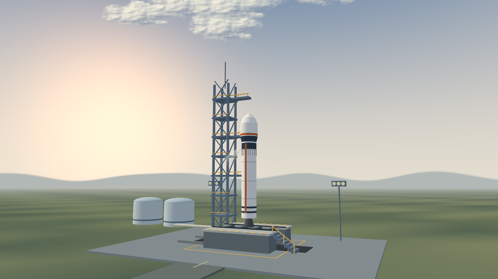
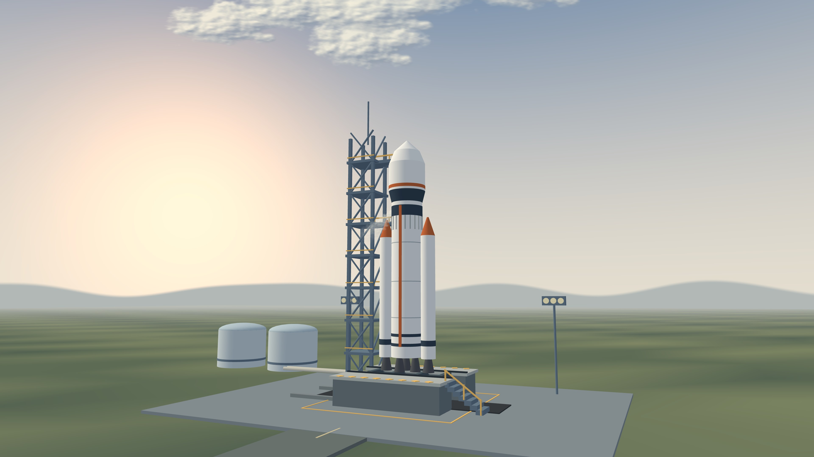
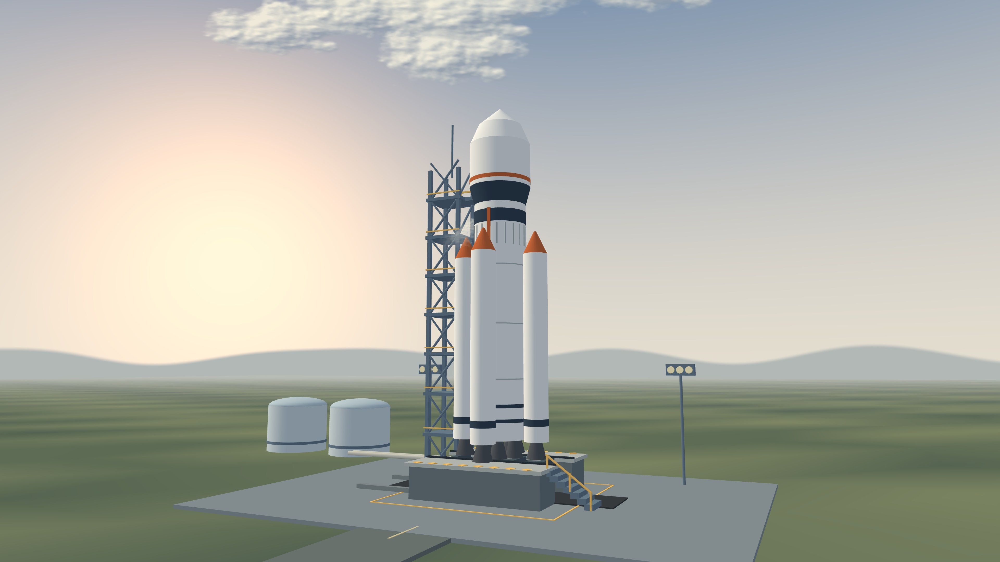
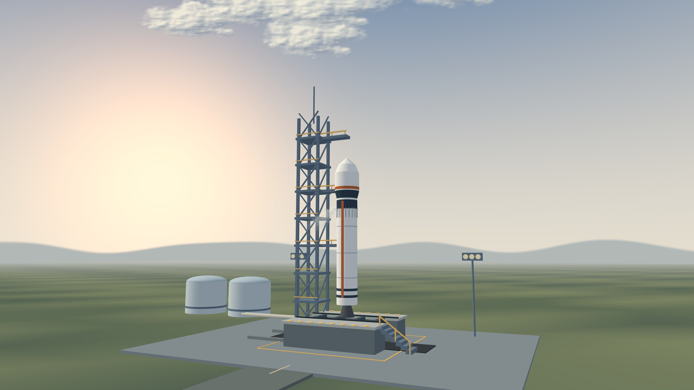
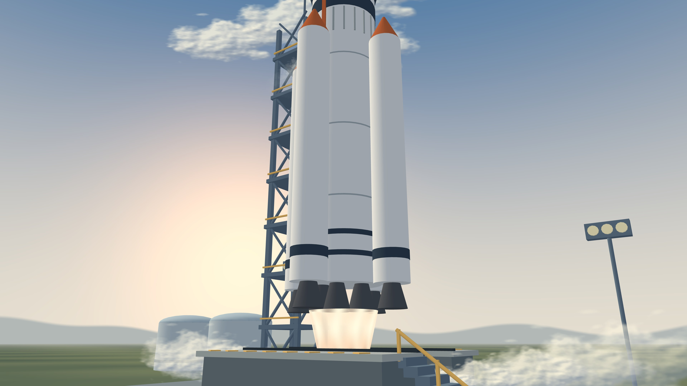
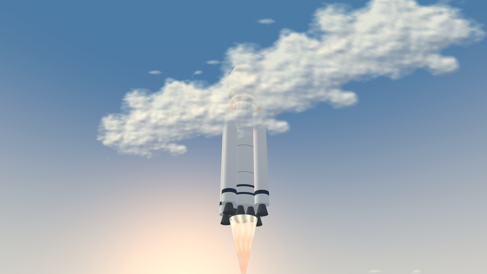
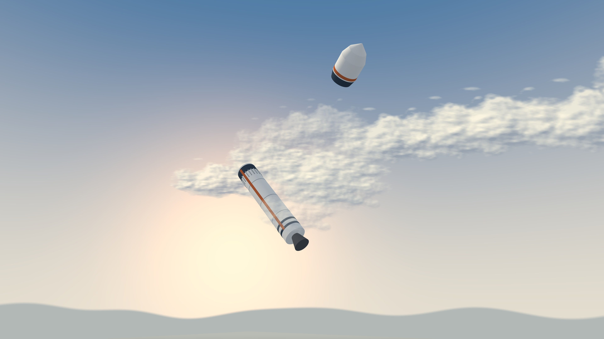

# Earth launch playtest

From the repository root on Windows, with Node.js 24 or later installed, run:

```powershell
.\run.bat
```

The launcher installs, builds and opens the game. Use its printed port in the links below if it differs from 4280. Choose **Start a new Program** if a saved Program is offered.

1. Open [seed 1](http://localhost:4280/?seed=1), keep the Meridian Medium, tick only Pathfinder Orbiter and choose **Launch Mission**. The wide shot shows the stack against the service tower. The camera cuts down to the deck at ignition (1.55 s), watches the rocket lift (2.3 s), then follows it past the access platforms (3.9 s) into the cloud shelf. The launch ends after nine seconds of playing time.
2. Open [seed 6](http://localhost:4280/?seed=6) and fly the same Medium and Pathfinder. The rocket climbs normally until 6.5 s, then the exhaust cuts out, a cloud forms at the separation and both sections tumble. The launch card and Turn summary record the failure. Listen for ignition at the low angle and the breakup at separation.
3. Try the Heavy in a new Program. To fly the Colossus, follow [Phase 8](phase-8.md#scenario) through step 4 on seed 233, then choose the developed Colossus and Pathfinder in the next Planning Mode. Each vehicle stands on the same pad. The Medium reaches below the highest access arm, the Heavy nearly reaches it, and the Colossus rises above it.
4. Pause during ignition. The flame, venting vapour and steam hold their places. Resume, then try **Steady camera** to watch the flight from a single fixed position. **Skip launch scene** dismisses the shot. A view tab takes you straight to that view. Repeat at 20x and check the speed after dismissing. End a Turn without launching to see the ordinary view from the outset.

## Compare the opening silhouettes

Order A, B and C from smallest to largest using the tower, fairings and boosters. Each image opens at its native pixel dimensions. All were taken at 0.6 s with the same camera, aspect ratio and pixel density.

| Desktop   | A                                                                                   | B                                                                                   | C                                                                                   |
| --------- | ----------------------------------------------------------------------------------- | ----------------------------------------------------------------------------------- | ----------------------------------------------------------------------------------- |
| 1920×1080 | [](../screenshots/launch-a.png)           | [](../screenshots/launch-b.png)           | [](../screenshots/launch-c.png)           |
| 3840×2160 | [](../screenshots/launch-a-2160.jpg) | [](../screenshots/launch-b-2160.jpg) | [](../screenshots/launch-c-2160.jpg) |

<details>
<summary>Reveal the vehicle labels</summary>

| Desktop   | Meridian Heavy                                                                      | Meridian Colossus                                                                   | Meridian Medium                                                                     |
| --------- | ----------------------------------------------------------------------------------- | ----------------------------------------------------------------------------------- | ----------------------------------------------------------------------------------- |
| 1920×1080 | [](../screenshots/launch-a.png)           | [](../screenshots/launch-b.png)           | [](../screenshots/launch-c.png)           |
| 3840×2160 | [](../screenshots/launch-a-2160.jpg) | [](../screenshots/launch-b-2160.jpg) | [](../screenshots/launch-c-2160.jpg) |

At both sizes the Medium has one slim barrel, the Heavy has two shoulder boosters and the Colossus has the widest core and clustered boosters. Their noses form three distinct heights against the tower. The silver bands and safety railings are clearer at native 4K.

</details>

## Inspect the shots

| Desktop   | Low angle, Colossus at 3.3 s                                                                             | Cloud entry, Colossus at 8.65 s                                                                 | Breakup, Medium at 7.7 s                                                                              |
| --------- | -------------------------------------------------------------------------------------------------------- | ----------------------------------------------------------------------------------------------- | ----------------------------------------------------------------------------------------------------- |
| 1920×1080 | [](../screenshots/launch-ignition-1080.jpg) | [](../screenshots/launch-cloud-1080.jpg) | [](../screenshots/launch-breakup-1080.jpg) |
| 3840×2160 | [](../screenshots/launch-ignition-2160.jpg) | [](../screenshots/launch-cloud-2160.jpg) | [](../screenshots/launch-breakup-2160.jpg) |

The deck framing crops the top of the largest vehicles so the engines, stairs and trench exhaust occupy the frame. In the tracking shot the cloud shelf obscures the successful stack nose-first. The two pieces of a failed stack remain visible above and below the separation cloud.

## Measure the launch

After installing the repository dependencies and Playwright Chromium, run this from the repository root to repeat the measurements and save fresh shots:

```powershell
node scripts/review-launch.mjs --shots test-results/launch-review --seconds 4
```

The development-only page mounts the same launch renderer and repeats 3.2–3.85 s of the Colossus launch. This is the low-angle shot with the largest stack, a hot plume, both trench outlets venting and the pad filling the foreground. It draws 30 calls per frame. The canvas fills the specified desktop at one device pixel per CSS pixel. In normal Mission Mode the events column and controls occupy some of this space.

Measurements below are animation-frame intervals in milliseconds for three warmed four-second runs per configuration on Windows, 25 November 2026. The native renderer reported an NVIDIA GeForce RTX 4090 through Direct3D 11. The forced software renderer reported ANGLE SwiftShader. Refresh was 60 Hz. Frame intervals include browser scheduling and compositing and vary with machine load.

| Renderer    | Desktop   | Median by run (ms)   | 95th percentile by run (ms) |
| ----------- | --------- | -------------------- | --------------------------- |
| RTX 4090    | 1920×1080 | 16.7 / 16.7 / 16.7   | 16.7 / 16.8 / 16.8          |
| RTX 4090    | 3840×2160 | 16.7 / 16.7 / 16.7   | 16.8 / 16.8 / 16.8          |
| SwiftShader | 1920×1080 | 33.3 / 33.3 / 33.3   | 33.4 / 50.0 / 33.4          |
| SwiftShader | 3840×2160 | 50.1 / 116.7 / 116.7 | 183.3 / 133.4 / 133.4       |

Before the new shots, a single four-second sample on the same machine gave 16.7 ms median for both native resolutions and for software at 1080p, and 50.0 ms for software at 4K. The original camera stayed wide. The closer deck shot fills many more pixels with overlapping exhaust and vapour. The reviewed scene bakes cloud detail into one small texture, batches all cloud particles into a single draw, and interpolates sunlight across each barrel. These choices preserve the silhouette and hardware frame rate while limiting software shading cost. An earlier version with per-pixel lighting and denser steam gave 50.0 ms median at 1080p and 150.0 ms median of runs at 4K on SwiftShader. At full 4K the final software-rendered ignition still stutters.
