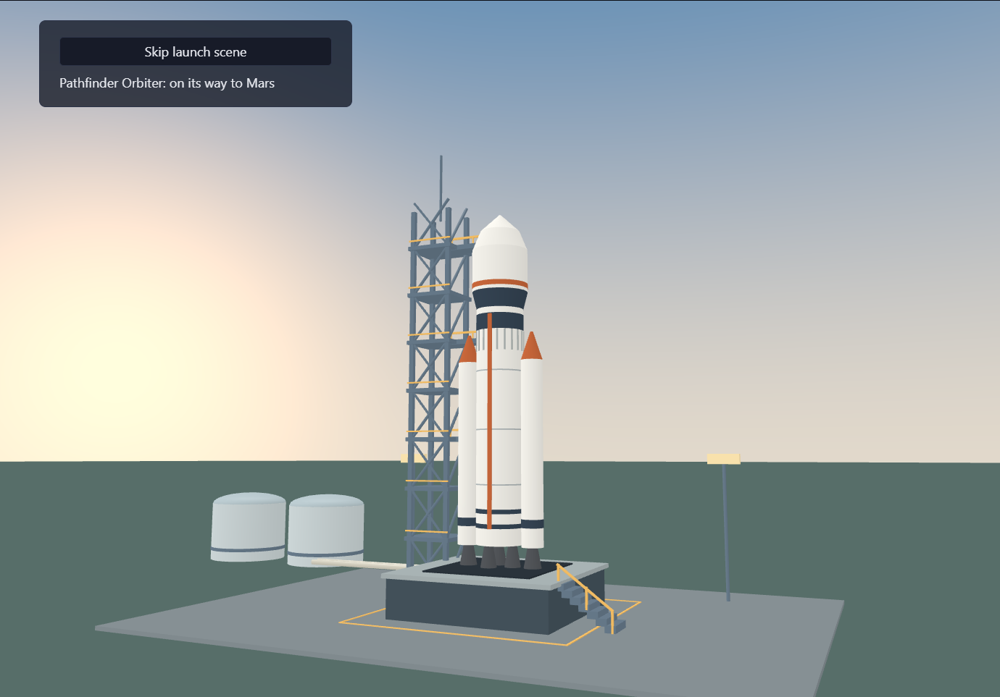
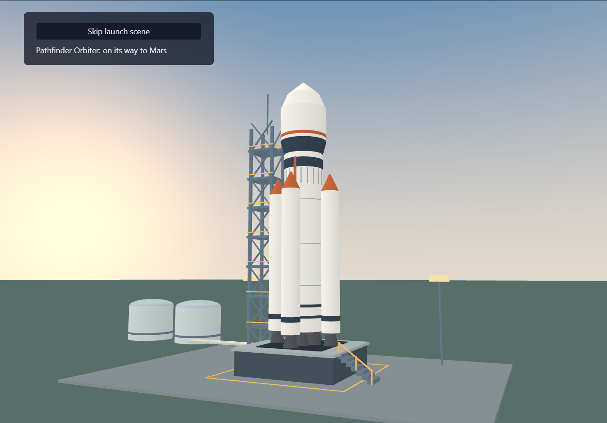

# Earth launch playtest

Order these unlabelled opening shots from smallest to largest rocket. Use the tower and platforms as references. Each image opens at full size.

| A                                                                       | B                                                                       | C                                                                       |
| ----------------------------------------------------------------------- | ----------------------------------------------------------------------- | ----------------------------------------------------------------------- |
| [](../screenshots/launch-a.png) | [](../screenshots/launch-b.png) | [](../screenshots/launch-c.png) |

<details>
<summary>Check your order</summary>

C is the Meridian Medium, A is the Heavy and B is the Colossus.

</details>

From the repository root on Windows, with Node.js 24 or later installed, run:

```powershell
.\run.bat
```

1. Start a new Program. Keep the Meridian Medium, tick Pathfinder Orbiter and choose **Launch Mission**. Watch the stack against the service tower, the engine light and the vehicle clear the pad. Space pauses the climb and steam. Space again resumes them. After about nine seconds the mission view takes over.
2. Repeat with the Meridian Heavy. To fly the Colossus, follow the [Phase 8 playtest](phase-8.md) through step 4 using seed 233. In the next Planning Mode, select the developed Colossus and Pathfinder Orbiter and launch. Compare the boosters and barrel width against the same tower.
3. During launch, choose **Skip launch scene**. The map appears immediately and the Turn continues at the selected speed. Repeat while paused, or click a view tab during launch. The chosen view and playback speed should hold. End a Turn without launching to see the ordinary view from the outset.
4. For a repeatable breakup, start a new Program at [seed 6](http://localhost:4280/?seed=6), keep the Medium and choose only Pathfinder Orbiter. Use the port printed by the launcher if it differs. The rocket should climb, cut out and separate into two tumbling parts. The event card and Turn summary should both record the launch failure. [Seed 1](http://localhost:4280/?seed=1) gives the same mission a successful launch.
